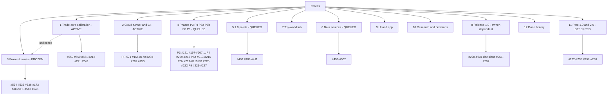

# Work hierarchy, 2026-11-14

Whole project as nested groups ordered by position in the development queue: active, queued, frozen or blocked, deferred. Sources: open and closed issues in animal-spirits/ceteris (91 open, 71 closed at fetch, PRs excluded), `reports/progress-2026-11-12.md`, `reports/delivery-risk-2026-11-13.md`, `reports/ui-schedule-2026-11-10.md`, `reports/infrastructure-gaps-2026-11-10.md`, `rfcs/` statuses (110 accepted, 214 proposed, 4 draft/rejected/superseded/deferred). Group order 1-4 follows the order given in chat on 2026-11-13; groups 5-12 extend it. Issue ids are `#n`; PR-only items are `PR n`. Phase membership follows issue labels; state is a judgement from the 13 Nov kernel freeze and open dependencies, not a GitHub field. Closed items are collapsed to counts.

## Tree

```
CETERIS
|- 1 Trade-core calibration                                 ACTIVE (flagship scenario gate, RFC 0350 bands)
|  |- #559 H2 distance elasticity -0.472 vs [-1.1,-0.7]     active (epsilon fit 0.3723, 1/4 held-out classes pass)
|  |- #560 Brexit UK welfare 4-5x too small                 queued
|  |- #561 Turn E3 price package on; fix e3 benchmark       queued (e3 benchmark fails)
|  |- #212 P4 ADR 0272 log-distance friction, 50-goods recal queued (after PR 3: per-class d_0 vector)
|  |- #241 PPML thetas do not reproduce class spread        queued
|  `- #242 Price and wage speeds to micro moments           queued
|
|- 2 Cloud runner and CI infra                              ACTIVE/QUEUED
|  |- PR 571 fit-trial cache and cloud runner scripts       active
|  |- #166 CI speed study                                   queued
|  |- #169 Rerun #124 benchmark on idle Mac                 blocked (Mac)
|  |- #170 Nightly gate check                               queued (.github/: Antonio only)
|  |- #250 Repo settings: up-to-date branches, rows check   queued (Antonio)
|  |- #203 P3 H: reproducible cross-platform job            queued (Linux x86_64, aarch64)
|  |- #202 P3 G: perf gates (flatness, 45-goods, bounds)    queued
|  `- done: PR 517 hosted PR checks
|
|- 3 Frozen kernels (KERNEL FREEZE 11-13)                   FROZEN until flagship passes
|  |- #534 Wire investment pipeline (P5 D1)                 frozen
|  |- #535 Wire entry/exit/zombie band (P5 D2)              frozen (parked)
|  |- #536 Wire structural change (P4 E)                    blocked by #173
|  |- #173 ADR 0108 catch-up term                           queued behind freeze
|  |- Banks F1 impl (RFC 0352 merged, PR 562)               frozen
|  |- #543 Monetary follow-ups (output gap, FX peg, rate)   frozen
|  |- #546 Fiscal follow-ups (ledger money, budgets, K)     frozen
|  `- done: wiring #528-#533 (6), kernels #480, PR 487
|
|- 4 Phases
|  |- P3 workbench (27 issues; 8 closed)                    QUEUED
|  |  |- #171 P3 gate; #205 J golden scenario + 100y run + tariff experiment
|  |  |- #200 E short-run adjustment, fitted rho (run first)
|  |  |- #197 L ensemble lanes; #201 F CLI verbs, exports, share/fetch
|  |  |- #204 W workbench views W1-W4
|  |  |- #206 50-goods pack; #207 Walrasian clearing; #158 traded services
|  |  |- #172 half-life tuning; #175 SFI steel/50-goods fetch
|  |  |- Tick speed: #189 #236 #237 #238 #239 #240            (queued, after Right gates)
|  |  `- Pre-P3 leftovers: #160 #180 #181 #182 #190 #243      (#160 bug)
|  |- P4 population (6)                                      QUEUED
|  |  |- #209 Brass mortality/fertility, education
|  |  |- #210 occupational mobility, DDC migration
|  |  |- #211 balanced-growth calibration, i128 money
|  |  |- #244 PWT price levels disagree (research)
|  |  `- #212 (see group 1)
|  |- P5a money and fiscal (4)                               QUEUED
|  |  |- #213 currencies, regimes, rules, taxes, SFC
|  |  |- #214 quarterly investment step
|  |  |- #215 split price rule, traded-market anchor
|  |  `- #216 storage-on frictionless V1 fix (RFC 0286)
|  |- P5b banks, debt, flows (4)                             QUEUED, behind freeze
|  |  |- #217 banks, housing, equity, sovereign debt, IMF
|  |  |- #218 sequence-space HANK reference
|  |  `- #219 endogenous hazards (ADR 0242)
|  |- P8 growth and energy (5)                               QUEUED, behind freeze
|  |  |- #220 frontier growth, jumps, catch-up (needs #173)
|  |  |- #221 learning curves, structural change, emissions
|  |  `- #222 pandemics (SEIR), chokepoints, energy scope
|  `- P9 calibration (11)                                    QUEUED
|     |- #223 pre-registration, joint block check
|     |- #224 SBI, emulators, Sobol
|     |- #225 hindcast 2011-2024; #226 origin packs 2005/2010
|     |- #227 Real/Dual<N> retrofit, RE storage switch
|     |- #246 held-out scorer; #247 leave-one-region-out
|     `- #241 #242 (group 1)
|
|- 5 1.0 polish (P1 P2 P7 P8, RFCs 0333 0334)                 QUEUED after P3 gate
|  |- #408 P1 first-run path, prebuilt pack
|  |- #409 P2 showcase scenarios
|  |- #411 P8 Steam path, macOS and Linux
|  `- done: #410 P7 stability pack
|
|- 6 Data sources (9 issues; 5 closed)                        QUEUED
|  |- #499 EIA energy (ADR 0358; Mac fetch for sha256)
|  |- #500 ADB MRIO held-out; #501 Malaria Atlas; #502 HMD
|  `- done: #498 #503 #504 #505 #506, 583/583 pins
|
|- 7 Toy-world lab
|  |- #474 W2/W4 zoo batch 1, literature baseline             queued
|  `- done: #471 W1, #477 W5, #524
|
|- 8 Release 1.0 (13 issues; 2 closed)                        QUEUED, owner-dependent
|  |- #228 user-side pack fetch, signed macOS build, cross-arch hashes
|  |- #229 minimal pedia; #230 flip to open, fork-rename policy
|  |- #231 NC-data audit for paid Steam build
|  |- Decisions awaiting Antonio: #261 trademark, #262 when to sell,
|  |    #263 Steam price, #264 NC data in paid build, #265 downloader form,
|  |    #266 music, #267 employer filing
|  |- Licensing: AGPL simulator + BUSL-style game, CLA (RFC 0343/0344, PR 514 519)  done in spec
|  |- Infra gaps (reports/infrastructure-gaps): signing/notarisation, Mac single
|  |    point of failure, pack hosting, crash reports, URL drift job, secrets, B2 backups
|  `- GitHub Support history purge PARKED; repo stays private until Antonio says go
|
|- 9 UI / app (see reports/ui-schedule-2026-11-10.md)
|  |- #204 W1-W4 (branch manager, difference map, fan charts, why panel)   queued; W2-W4 blocked on C3/C4
|  |- #208 lab-UI remainder: lenses, keyboard, exports               deferred (post-1.0)
|  |- Polish P3 lessons, P5 share UX, P6 run report, P11 UI polish, P13 performance feel   deferred/blocked
|  |- Accessibility (CVD, reduce-motion, 200% scale)                  deferred 1.x
|  `- done: #567 logo kit, #427 art mocks
|
|- 10 Research and decisions
|  |- 214 proposed RFCs (many already built; undercounts decided work)   queue: sweep as gates arrive
|  |- Post-1.0 ADR backlogs #257 (P3 era) #258 (P4) #259 (P5) #260 (P8/P9)   deferred
|  `- #179 Queue tracker (stale checkboxes)
|
|- 11 Post-1.0 / 2.0+                                         DEFERRED
|  |- #232 climate emulator and damages (1.1, ADR 0207)
|  |- #233 relief, conflict, Paradox cues (ADRs 0255 0254 0252)
|  |- #234 politics P6, war P7, Steward P10
|  |- #235 route choice past P2
|  `- 2.0 paid game mechanics (no railroading, ADR 0241/0242); 1.0 usage stats dropped
|
`- 12 Completed history: #278-#297 (20/20), pre-P3 15, wiring 6, data 5, misc
```

## Bullet list, queue order

1. Active: trade-core calibration (#559 now; #560, #561, #212, #241, #242 next). Cloud runner (PR 571 active; #166, #170, #203 behind it).
2. Frozen until a flagship scenario passes RFC 0350 bands: #534, #535, #536 (blocked by #173), banks F1, #543, #546.
3. Queued phases: P3 (gate #171), P4, P5a, then P5b, P8, P9 once the freeze lifts or their prerequisites land.
4. Queued polish and data: #408, #409, #411; #499-#502; #474.
5. Release: #228-#231 plus seven Antonio decisions (#261-#267); infra gaps; repo stays private pending purge.
6. UI: W1-W4 inside #204; accessibility, lessons, report export and UI polish deferred.
7. Deferred: #232-#235, backlog #257-#260, #208, 2.0 game mechanics.

## Diagram



## Caveats

- Group states beyond the first four are my reading of dependencies; Antonio has not reviewed them.
- Counts come from today's issue fetch and the 12 Nov progress report; they will drift.
- Issue-less work (infra gap items, banks F1 implementation) has no id yet; each needs an issue before work starts (CLAUDE.md: no work without an issue).
